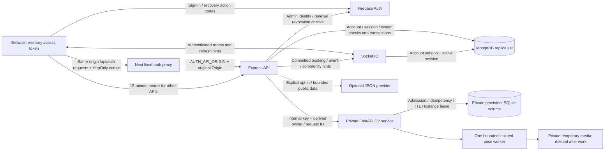

# Architecture and trust boundaries

Current source architecture, 2026-11-15. The diagram describes implemented
boundaries, not an assertion that a hosted deployment or the latest CI passed.
Run evidence and limits are tracked in [verification](VERIFICATION.md) and
[PR #2](https://github.com/pratikcoder01/Athlix/pull/2).

- Firebase proves the initial identity. Public registration creates athletes;
  professional roles require audited operator provisioning. Once linked to
  Firebase, the old bcrypt password cannot be used as an alternate login.
  Authenticated sign-in repairs only a missing baseline profile, preserving edits.
- The browser retains access tokens only in memory. A host-only HttpOnly refresh
  cookie restores a seven-day absolute session through a fixed same-origin Next
  rewrite. Only hashed rotating credentials are stored in MongoDB. Cookie
  mutations require a trusted Origin and session header. Access tokens require
  current account/session versions and active unexpired session records; global
  sign-out and operator role changes invalidate older versions. See
  [session security](SESSION_SECURITY.md) for rotation races and revocation timing.
- MongoDB is authoritative for profiles, plans, training history, booking
  reservations/notifications, academy operations, event divisions and community
  moderation. Caller IDs/roles, ownership and permitted field projections are
  checked by the API; the browser cannot choose another owner or a final price.
- Booking transactions coordinate both participants. Academy member/attendance
  transactions serialize against the academy's archive state. Event and division
  writes compare the parent event version/state. Community comment/report writes
  coordinate on the visible parent, while moderation decisions and audits share
  a transaction. Required unique indexes are part of deployment acceptance.
- Private training journals are caller-owned; coach client access derives from
  accepted/completed bookings and exposes pair-private notes rather than journals
  or private contacts. The stored notification inbox is recipient-scoped.
  Realtime events trigger authorized reloads; they are never authoritative state.
- The CV proxy authenticates before multipart parsing, requires consent and
  derives owner/request metadata. Python checks its internal credential before
  parsing uploads and admits one job. Private SQLite state coordinates bounded
  admission, idempotency, results and expiry under an exclusive instance lease.
  A persistent local volume preserves completed results until original expiry;
  interrupted work becomes an explicit failed job, and temporary media is removed.
- Docker/Compose supplies a non-root read-only container, private tmpfs, pinned
  model mount and CPU/memory/PID limits. The model is provisioned separately from
  a version/checksum manifest. Readiness checks file/schema/lease configuration;
  it does not certify native inference quality. This design is single-instance
  and does not support horizontal workers or network-file-system state.
- Experimental provider coaching is disabled by default and sends only bounded
  user instructions and public coaching fields when enabled. Returned structures
  are validated; stored plans remain privately readable with AI disabled. Kata
  reporting itself sends no video/landmarks to an external language-model service.

Live HTTPS proxy/cookie acceptance, existing-role provenance, deployed indexes
and resource/disk controls, permissioned native-video evaluation, legal review,
billing and supervised pilot qualification remain release gates. See
[feature status](FEATURE_STATUS.md) and [operations](OPERATIONS.md).
