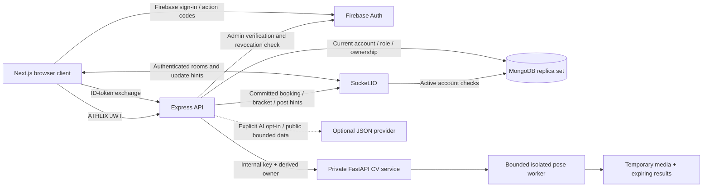

# Architecture and trust boundaries

Current source architecture, 2026-11-14. Infrastructure must be configured and
reviewed separately; the diagram does not assert that production services run.

- Firebase ID tokens are exchanged for an ATHLIX API JWT. HTTP and sockets verify
  that token and resolve a current active account. A role supplied by a public
  client is never a professional approval. Trusted CLI role changes and audits
  share a transaction; no operator action was executed on production.
- MongoDB is authoritative. Booking writes lock both participants before reading
  conflicts, then commit booking/notification changes in one transaction.
  Tournaments use versioned conditional writes and atomic enrollment. Realtime
  delivery is a hint; clients reload authorized persisted state.
- The browser never chooses a private notification room, a resource owner, a
  final booking price or a CV service key. Exact browser origin checks supplement
  authentication; they do not replace authorization.
- The video route authenticates before bounded multipart parsing, requires
  consent and forwards a server-derived owner. Python validates the internal
  secret/owner before upload parsing and runs one bounded child process. Temporary
  video is deleted; results expire. This store is ephemeral and cannot be scaled
  horizontally without a durable shared job design.
- Optional provider coaching is disabled by default. When reviewed and enabled,
  it sends bounded user instructions and explicitly public coaching fields,
  validates returned structures and enforces per-account limits. Kata reporting
  itself does not send video/landmarks to an external language-model provider.
- Browser token storage/revocation, existing role provenance, durable jobs,
  native decoder isolation, live-provider acceptance and full product operations
  remain release gates. See [feature status](FEATURE_STATUS.md),
  [verification](VERIFICATION.md) and [operations](OPERATIONS.md).
